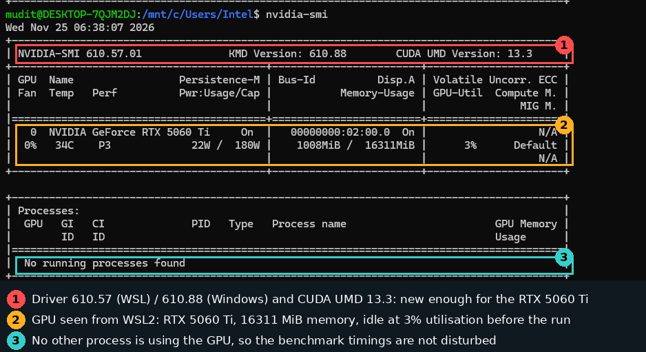
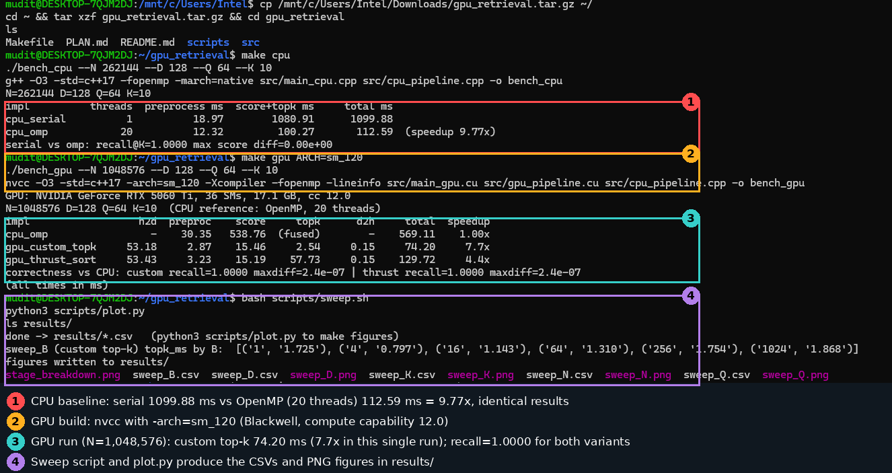
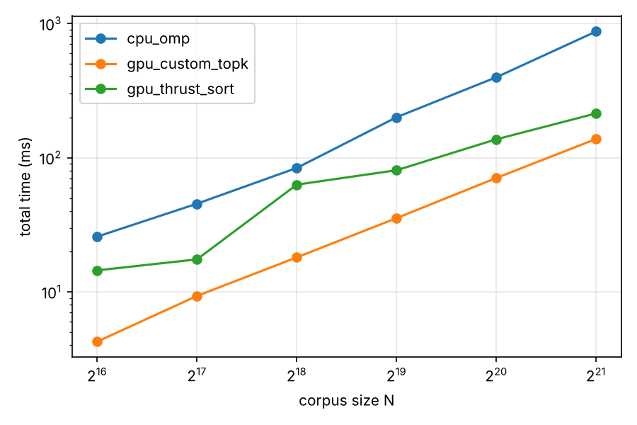
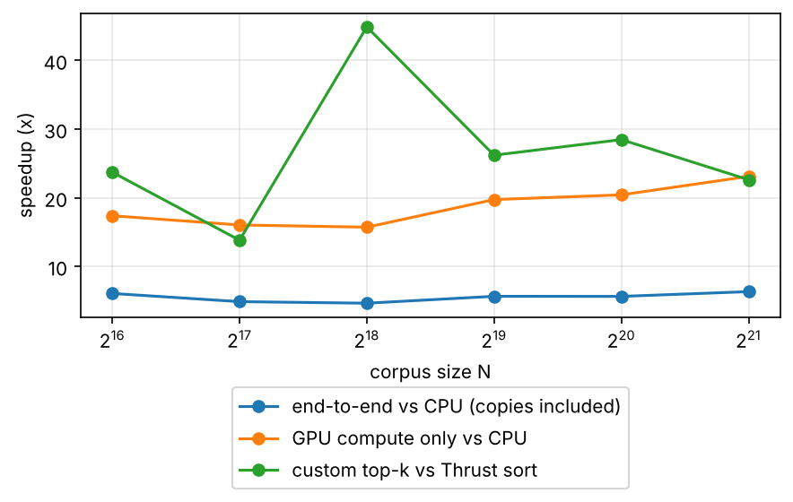
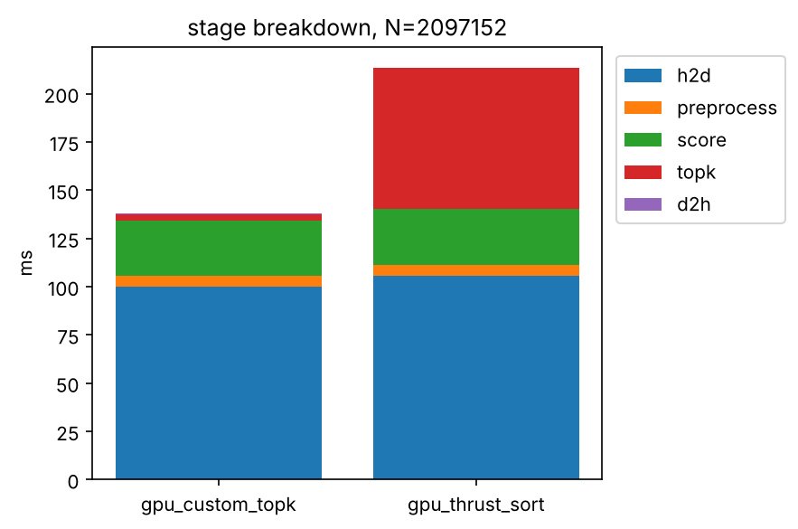
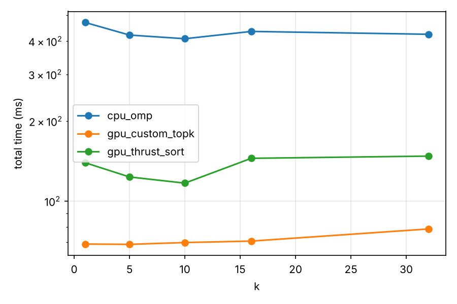
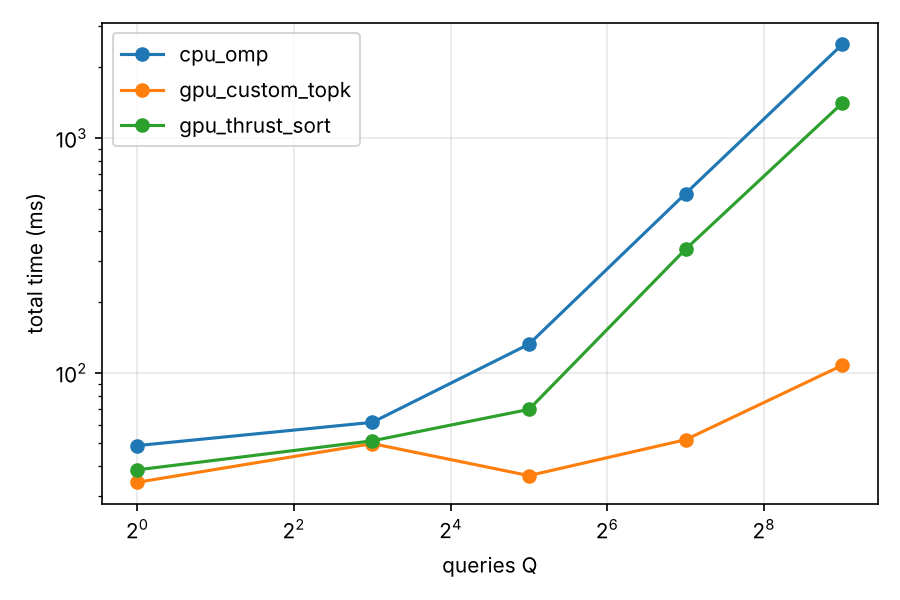
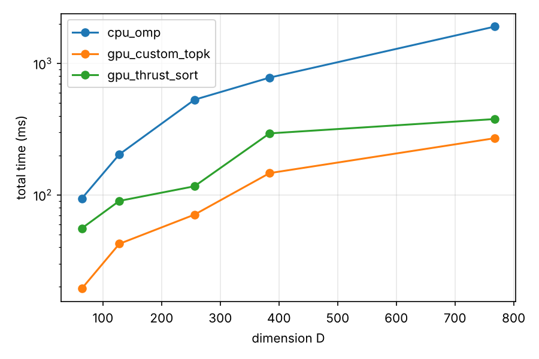

# GPU Retrieval Pipeline with Parallel Preprocessing and Top-k Selection

**Parallel & Distributed Computing Laboratory** · KLE Technological University (KLETECH), Hubballi
**Team:** Mudit Nayak · Kartik · Manoj · Vinayak  ·  **Guide / date:** _[add guide name and date]_

A CUDA implementation of exact dense retrieval (cosine similarity, top-k per query) with a serial CPU baseline, an OpenMP CPU baseline, a GPU pipeline with a custom two-stage top-k kernel, and a GPU pipeline that uses a full Thrust sort for comparison.

---

## Contents

1. [Problem](#1-problem)
2. [Pipeline design](#2-pipeline-design)
3. [Repository layout](#3-repository-layout)
4. [Test machine](#4-test-machine)
5. [Build and run, step by step](#5-build-and-run-step-by-step)
6. [Screenshots from the actual runs](#6-screenshots-from-the-actual-runs)
7. [Results (Python-generated)](#7-results-python-generated)
8. [Analysis](#8-analysis)
9. [Correctness](#9-correctness)
10. [Limitations](#10-limitations)
11. [Future work](#11-future-work)
12. [Troubleshooting](#12-troubleshooting)
13. [Other deliverables](#13-other-deliverables)

---

## 1. Problem

Given N corpus vectors of dimension D and Q query vectors, return for every query the K corpus vectors with the highest cosine similarity. This is the core of semantic search, retrieval-augmented generation and recommendation. Queries are independent and every corpus vector is scored the same way, so the problem maps well onto data parallelism.

The default workload is N = 1,048,576, D = 128, Q = 64, K = 10: 17.2 GFLOP of multiply-adds over a 537 MB corpus, producing a 268 MB score matrix from which only 10 values per query are kept.

## 2. Pipeline design

| Stage | What it does | GPU mapping |
|---|---|---|
| Transfer (H2D) | Copy raw vectors to the GPU | `cudaMemcpy` from pageable memory |
| **P1** Preprocess | L2-normalize every vector so cosine becomes a dot product | One block per vector, 128 threads, shared-memory tree reduction, `rsqrtf` |
| **P2** Score | Q x N matrix of dot products | 32x32 shared-memory tiles, padded to 32x33 (no bank conflicts), coalesced loads |
| **P3** Top-k | K best per query | Stage 1: B blocks per query (256 threads, private sorted list of K, then K rounds of block argmax). Stage 2: one block merges the B*K candidates |
| Transfer (D2H) | K ids and scores per query | small copy |

The baseline for P3 is a full per-row `thrust::sort_by_key` (O(N log N)). The custom kernel is a single O(N) pass and needs no atomics. It supports K up to 32. Queries are processed in batches so that the score matrix never exceeds 2^27 floats.

## 3. Repository layout

```
gpu_retrieval/
├── Makefile                 make cpu | make gpu ARCH=sm_120
├── PLAN.md                  original project plan
├── README.md                this file
├── src/
│   ├── common.h             shared types, timers, data generation
│   ├── cpu_pipeline.{h,cpp}  serial and OpenMP implementations
│   ├── main_cpu.cpp         CPU benchmark driver (bench_cpu)
│   ├── gpu_pipeline.{h,cu}   CUDA kernels and host orchestration
│   └── main_gpu.cu          GPU benchmark driver (bench_gpu)
├── scripts/
│   ├── sweep.sh             runs all sweeps, writes results/*.csv
│   └── plot.py              makes figures and results/summary.md
├── results/                 CSVs, PNG figures, summary.md, hardware.txt
├── docs/screenshots/        original and labelled terminal screenshots
├── presentation/            GPU_Retrieval_Pipeline.pptx (23 slides)
└── website/index.html       interactive project website (single file)
```

## 4. Test machine

| Item | Value |
|---|---|
| CPU | Intel Core Ultra 7 265K (20 threads used for OpenMP) |
| GPU | NVIDIA GeForce RTX 5060 Ti, 16 GB, 36 SMs, compute capability 12.0 |
| Driver | 610.88 (Windows), 610.57.01 (WSL) |
| CUDA | nvcc 13.3 (V13.3.73) |
| OS | Ubuntu 24.04 LTS on WSL2 (Windows 11) |
| Compiler | GCC 13.x, `-O3 -std=c++17 -fopenmp -march=native` |

## 5. Build and run, step by step

All commands run **inside WSL** (open "Ubuntu" or type `wsl` in PowerShell first; Linux commands such as `sudo` and `make` do not work in plain PowerShell).

**Step 1. Check the GPU is visible from WSL**

```bash
nvidia-smi
nvcc --version
```

**Step 2. Copy the project into the WSL home folder and enter it**

```bash
cp /mnt/c/Users/<you>/Downloads/gpu_retrieval.tar.gz ~/
cd ~ && tar xzf gpu_retrieval.tar.gz && cd gpu_retrieval
```

(If you received a zip instead: `unzip gpu_retrieval.zip && cd gpu_retrieval`.)

**Step 3. Build and run the CPU baseline**

```bash
make cpu
./bench_cpu --N 262144 --D 128 --Q 64 --K 10
```

**Step 4. Build and run the GPU pipeline** (`sm_120` is the RTX 50-series; use `sm_89` for RTX 40, `sm_86` for RTX 30, or `ARCH=native`)

```bash
make gpu ARCH=sm_120
./bench_gpu --N 1048576 --D 128 --Q 64 --K 10
```

**Step 5. Run all sweeps and make the figures**

```bash
bash scripts/sweep.sh
pip install matplotlib   # once, if needed
python3 scripts/plot.py
```

This writes `results/sweep_*.csv`, `results/*.png` and `results/summary.md`.

**Command-line options of `bench_gpu`:** `--N` corpus size, `--D` dimension, `--Q` queries, `--K` result size (max 32), `--reps` repetitions, `--B` stage-1 blocks per query (default auto), `--qbatch` queries per batch (default auto), `--seed` random seed, `--csv` machine-readable output.

## 6. Screenshots from the actual runs

### 6.1 GPU environment check (`nvidia-smi`)



| Label | Meaning |
|---|---|
| 1 | Driver 610.57 in WSL (610.88 on Windows) and CUDA 13.3: new enough for the RTX 5060 Ti |
| 2 | The GPU as seen from WSL2: RTX 5060 Ti, 16311 MiB, idle at 3 % utilisation before the run |
| 3 | No other process is using the GPU, so the timings are not disturbed |

Original: [01_nvidia-smi_original.png](docs/screenshots/01_nvidia-smi_original.png)

### 6.2 Build, CPU run, GPU run and sweep



| Label | Meaning |
|---|---|
| 1 | CPU baseline (N = 262,144): serial 1099.88 ms, OpenMP with 20 threads 112.59 ms, a 9.77x speedup, and the two results are identical (recall 1.0000, score difference 0) |
| 2 | GPU build with `nvcc -arch=sm_120` (Blackwell, compute capability 12.0) |
| 3 | First single GPU run at N = 1,048,576: custom top-k 74.20 ms, Thrust 129.72 ms, recall 1.0000 and max score difference 2.4e-07 for both |
| 4 | `sweep.sh` and `plot.py` produce the CSVs and PNG figures in `results/` |

Note on label 3: the 7.7x shown there compares against a single CPU run of 569 ms. The same CPU configuration was measured at 397 to 569 ms across runs, while the GPU stayed at 70 to 74 ms. The sweeps below (best of repeated runs) give the more reliable range of **4.6x to 6.3x** end to end.

Original: [02_build_and_run_original.png](docs/screenshots/02_build_and_run_original.png)

> More screenshots (for example htop/Task Manager showing the 20 OpenMP threads, or the plots opened in a viewer) can be added to `docs/screenshots/` and referenced here.

## 7. Results (Python-generated)

All tables below are produced by `scripts/plot.py` from the CSV files in `results/` (`results/summary.md`). Times are milliseconds. "GPU custom" and "GPU Thrust" are end-to-end times including the host-to-device copy.

### Corpus size N (D=128, Q=64, K=10)

| N | CPU 20 thr (ms) | GPU custom (ms) | GPU Thrust (ms) | speedup custom | custom top-k (ms) | Thrust top-k (ms) |
|---:|---:|---:|---:|---:|---:|---:|
| 65,536 | 25.8 | 4.3 | 14.4 | 6.1x | 0.41 | 9.7 |
| 131,072 | 45.4 | 9.3 | 17.4 | 4.9x | 0.65 | 9.0 |
| 262,144 | 83.8 | 18.1 | 62.9 | 4.6x | 1.00 | 45.1 |
| 524,288 | 200.0 | 35.4 | 80.5 | 5.6x | 1.49 | 39.1 |
| 1,048,576 | 397.4 | 70.5 | 137.0 | 5.6x | 2.22 | 63.1 |
| 2,097,152 | 871.8 | 137.8 | 213.6 | 6.3x | 3.24 | 73.4 |

### K (N=1,048,576, D=128, Q=64)

| K | CPU 20 thr (ms) | GPU custom (ms) | GPU Thrust (ms) | speedup custom | custom top-k (ms) | Thrust top-k (ms) |
|---:|---:|---:|---:|---:|---:|---:|
| 1 | 469.8 | 69.0 | 139.4 | 6.8x | 0.76 | 66.1 |
| 5 | 421.4 | 68.8 | 123.3 | 6.1x | 1.09 | 48.6 |
| 10 | 408.2 | 69.8 | 116.8 | 5.8x | 2.23 | 48.5 |
| 16 | 434.8 | 70.7 | 144.9 | 6.1x | 4.08 | 71.0 |
| 32 | 424.3 | 78.6 | 147.7 | 5.4x | 11.62 | 70.9 |

### Queries Q (N=524,288, D=128, K=10)

| Q | CPU 20 thr (ms) | GPU custom (ms) | GPU Thrust (ms) | speedup custom | custom top-k (ms) | Thrust top-k (ms) |
|---:|---:|---:|---:|---:|---:|---:|
| 1 | 49.0 | 34.2 | 38.6 | 1.4x | 0.09 | 3.4 |
| 8 | 61.5 | 50.0 | 51.3 | 1.2x | 0.42 | 9.3 |
| 32 | 132.5 | 36.5 | 69.9 | 3.6x | 1.05 | 33.1 |
| 128 | 580.4 | 51.9 | 336.2 | 11.2x | 2.50 | 277.5 |
| 512 | 2505.7 | 107.6 | 1408.4 | 23.3x | 7.63 | 1271.6 |

### Dimension D (N=524,288, Q=64, K=10)

| D | CPU 20 thr (ms) | GPU custom (ms) | GPU Thrust (ms) | speedup custom | custom top-k (ms) | Thrust top-k (ms) |
|---:|---:|---:|---:|---:|---:|---:|
| 64 | 94.0 | 19.4 | 55.8 | 4.8x | 1.52 | 37.4 |
| 128 | 203.7 | 42.5 | 90.1 | 4.8x | 1.51 | 51.8 |
| 256 | 529.9 | 70.8 | 116.4 | 7.5x | 1.52 | 45.8 |
| 384 | 780.2 | 146.6 | 293.9 | 5.3x | 1.55 | 144.0 |
| 768 | 1907.9 | 270.2 | 377.7 | 7.1x | 1.51 | 92.6 |


### Figures (from `scripts/plot.py`)

**Scaling with corpus size**



**End-to-end speedup, compute-only speedup and custom top-k versus Thrust**



**Where the time goes (N = 1,048,576)**



**Effect of K**



**Effect of the number of queries Q**



**Effect of the embedding dimension D**



**Stage-1 block count B** (N = 1,048,576, Q = 16, custom top-k only): top-k time by B is 1.73 ms (B=1), 0.80 (4), 1.14 (16), 1.31 (64), 1.75 (256), 1.87 (1024). These values are small and noisy, so B = 4 being best should not be over-read.

## 8. Analysis

**Headline numbers** (D = 128, Q = 64, K = 10 unless stated)

| Metric | Result |
|---|---|
| End-to-end speedup over 20 CPU threads, including transfer | 4.6x to 6.3x |
| Compute-only speedup (preprocess + score + top-k) | 16x to 23x |
| Custom top-k versus full Thrust sort | 14x to 45x across N (167x at Q = 512) |
| Scoring kernel throughput | about 1.2 TFLOPS (17.2 GFLOP in 14.4 ms) |
| Host-to-device copy | 537 MB in about 51 ms, roughly 10.5 GB/s from pageable memory |

1. **The copy is the bottleneck.** At N = 1,048,576 the GPU run takes 70.5 ms, of which 50.9 ms (72 %) is the host-to-device transfer. Preprocess 2.9 ms, score 14.4 ms and top-k 2.2 ms together are only 19.5 ms. This is why the compute-only speedup (16x to 23x) is much larger than the end-to-end speedup.
2. **The custom top-k is the main algorithmic gain.** Sorting every row costs 63 ms at this size against 2.2 ms for the two-stage selection. With the Thrust variant, top-k becomes the slowest GPU stage.
3. **K matters for the custom kernel, not for sorting.** Custom top-k grows from 0.76 ms (K = 1) to 11.6 ms (K = 32) because each thread's insertion list gets longer, yet it is still about 6x faster than sorting at K = 32.
4. **Batch size matters.** With one query the speedup is only 1.4x, because the corpus copy costs about 29 ms regardless of Q. At 512 queries it is 23x.
5. **Throughput estimates** (1.2 TFLOPS, about 93 GB/s of scoring traffic) are derived from measured times and are estimates. Both are well below the hardware peak, which suggests cuBLAS or tensor-core scoring and overlapped, pinned transfers as the next improvements.

## 9. Correctness

Every run compares the GPU result with the CPU result. Across all 48 GPU runs in the sweeps, recall@K was **1.0000** for both the custom top-k and the Thrust variant, and the maximum score difference was **3.58e-07** (float32 rounding). Serial and OpenMP CPU results are identical.

## 10. Limitations

- **Run-to-run variance.** The same CPU configuration took 397 to 569 ms in different runs, so speedups are reported as ranges, not a single number. The D = 384 row shows an unexplained preprocessing outlier (26.9 ms against about 3 ms at D = 256); it was not investigated.
- Synthetic random vectors, not real embeddings (the cost per vector is the same, the structure differs).
- Single GPU, single machine, WSL2 (which can add transfer overhead compared with native Linux).
- K is limited to 32; the full Q x N score matrix is materialized (in batches).
- The CPU reference is plain loop code, not an optimized BLAS library, so the CPU baseline could be improved.
- The 49 % parallel efficiency of the OpenMP baseline (9.77x on 20 threads) was not profiled; memory bandwidth and the mix of performance and efficiency cores are plausible causes.

## 11. Future work

- Pinned host memory and CUDA streams to overlap the copy with compute (largest single gain).
- cuBLAS SGEMM, FP16 or tensor-core scoring, and a fused score + top-k kernel that avoids the 268 MB score matrix.
- Radix-select for K above 32, multi-GPU sharding for larger corpora, and real embedding datasets.

## 12. Troubleshooting

| Problem | Fix |
|---|---|
| `sudo` or `make` "not found" / sudo disabled message in PowerShell | You are in Windows PowerShell. Type `wsl` first. |
| Forgot the WSL password | In PowerShell: `wsl -u root`, then `passwd <your-username>` (list users with `ls /home`), then `exit` |
| `nvidia-smi` not found in WSL | Update the NVIDIA Windows driver; do not install a Linux display driver inside WSL |
| `nvcc: command not found` | Install the CUDA toolkit for WSL-Ubuntu and add `/usr/local/cuda/bin` to `PATH` |
| `nvcc fatal: Unsupported gpu architecture` | Use `ARCH=sm_89` / `sm_86`, or `ARCH=native`, to match your GPU |
| `bench_gpu` says it must be built first | Run `make gpu ARCH=...` before `bash scripts/sweep.sh` |
| `matplotlib` missing | `pip install matplotlib` (add `--break-system-packages` on Ubuntu 24.04 if pip refuses) |
| Very different CPU timings between runs | Close other programs and repeat; report ranges |

## 13. Other deliverables

- `presentation/GPU_Retrieval_Pipeline.pptx`: 23-slide deck with speaker notes, native charts and tables.
- `website/index.html`: single-file interactive project website (open in any browser).
- `PLAN.md`: the original project plan.
